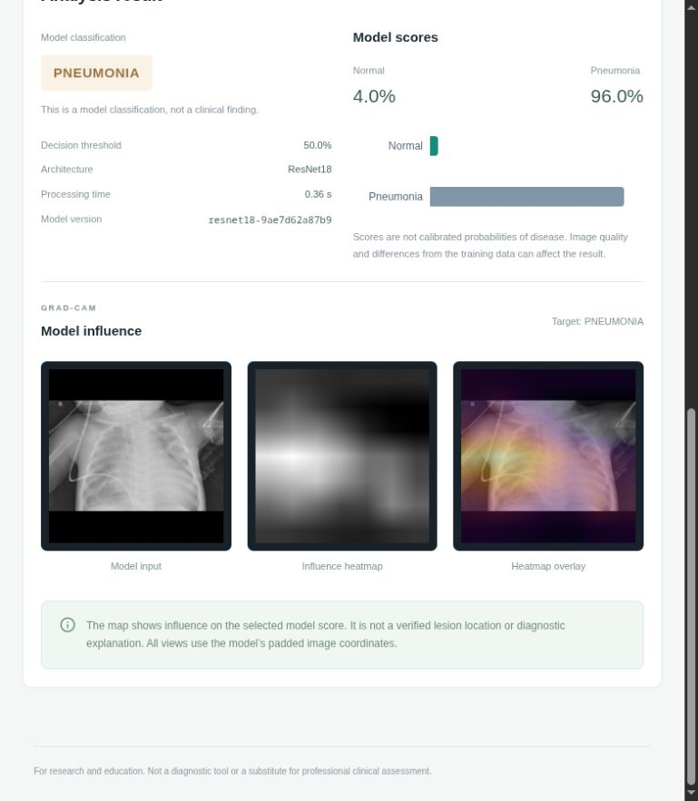
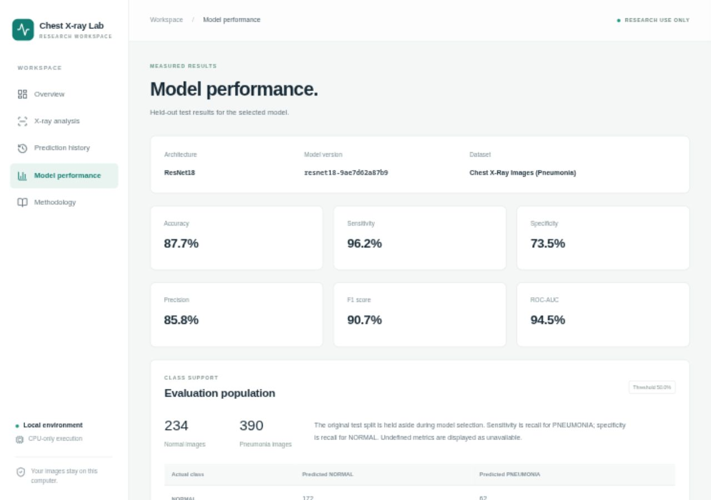

# Chest X-ray Pneumonia Classification

A local, CPU-only ResNet18 project with Jupyter notebooks, a FastAPI backend, and a Next.js dashboard.
It classifies chest X-rays as NORMAL or PNEUMONIA and displays Grad-CAM maps of model influence.
For education and research; predictions must not be used for patient care.

## Setup

Tested on Fedora 44 with an Intel Core i5-4590S and 12 GB RAM. Python 3.11, PyTorch 2.10.0+cpu,
Torchvision 0.25.0+cpu, and Node.js 22 run in separate Conda environments. No GPU packages are needed.

From the project root:

```bash
conda env create -f environment.yml
conda activate chest-xray-cpu
python -m pip install -r requirements-cpu.txt
python -m pip install -r requirements-lock.txt
python -m pip install --no-deps -e .
python -m ipykernel install --user --name chest-xray-cpu --display-name 'Chest X-ray (CPU)'
conda env create -f environment-web.yml
conda run -n chest-xray-web npm --prefix frontend ci
conda run -n chest-xray-web npm --prefix frontend run build
```

## Run locally

After training, evaluation, and export, start each service in a separate terminal:

```bash
bash scripts/run_backend.sh
```

```bash
bash scripts/run_frontend.sh
```

Open [the dashboard](http://127.0.0.1:3000) or [API documentation](http://127.0.0.1:8000/docs).
The app loads `artifacts/model/model.pt`; it shows an unavailable state if the model is missing.

Copy `.env.example` to `.env` to change backend settings. History is off by default. Setting
`HISTORY_ENABLED=true` enables optional SQLite result metadata; original images and heatmaps
are never saved in history. Uploads accept JPEG or PNG, up to 8 MiB, 4096 pixels per side, and 12 MP.

For experiments, activate `chest-xray-cpu`, run `jupyter lab --ip=127.0.0.1`, and select the
**Chest X-ray (CPU)** kernel.

## Dataset

[Chest X-Ray Images (Pneumonia), Kaggle](https://www.kaggle.com/datasets/paultimothymooney/chest-xray-pneumonia)
contains 5,856 images in the selected extraction. Images live under `chest_xray/`; its identical
nested copy is preserved but not loaded twice. The uploaded dataset remains tracked in this
private repository. Original images are unchanged.

Dataset checks found no unreadable images, but did find duplicates and filename-derived groups
crossing the original splits. The manifest excludes 457 development images linked to test groups
and 22 further pixel duplicates, without removing files.

| Split | NORMAL | PNEUMONIA | Total |
| --- | ---: | ---: | ---: |
| Training | 1,071 | 2,716 | 3,787 |
| Validation | 269 | 681 | 950 |
| Original test | 234 | 390 | 624 |

The original 16-image validation split is retained as an unused auxiliary set. Filename groups
are only patient proxies; they do not establish patient independence.

## Training and evaluation

Notebooks 01–03 cover dataset checks, preprocessing, and model development. Notebook 04 runs
an opt-in smoke test before full training. Reusable code is in `ml/`.

Defaults: batch size 8, 224 × 224 RGB images, two CPU threads, zero DataLoader workers, float32,
and no image cache. Resize preserves aspect ratio with black padding, then applies ImageNet
normalization. Training adds up to 5° rotation and 2% translation; there are no flips or crops.
Reduce batch size to 4 or 2 for a new run if memory is tight.

The pretrained backbone and its BatchNorm statistics stay frozen while the classifier trains.
Full training requires approval. Five head-training epochs are configured, with early stopping
and checkpoint selection by validation ROC-AUC. Fine-tuning is off; the threshold stays at 0.5.

To resume, set `RESUME_PATH` in notebook 04 to `artifacts/checkpoints/run/last.pt`. Keep the
same configuration. An unfinished epoch replays from the last saved boundary, including
optimizer, scheduler, and random state. Progress bars, epoch timing, and learning curves are recorded.

Notebook 05 evaluates the selected model once on the untouched test set and exports it for the
app. Notebooks 06–07 check Grad-CAM and inference using that exported model. Reports, model
weights, and executed notebook copies stay in local `artifacts/` directories.

## Results

The approved five-epoch run selected epoch 5 by validation ROC-AUC
(0.99280). The held-out test set was evaluated once at threshold 0.5.

| Test metric | Value |
| --- | ---: |
| Accuracy | 87.66% |
| Precision | 85.81% |
| Sensitivity / recall | 96.15% |
| Specificity | 73.50% |
| F1 | 90.69% |
| ROC-AUC | 94.49% |

Confusion matrix, with rows = actual class and columns = predicted class:

| | NORMAL | PNEUMONIA |
| --- | ---: | ---: |
| NORMAL | 172 | 62 |
| PNEUMONIA | 15 | 375 |

These are dataset results, not evidence of clinical effectiveness. Scores are not calibrated
disease probabilities. No validated INCONCLUSIVE score band is enabled. The pediatric collection,
limited acquisition setting, possible patient overlap, and domain shift limit generalization.
Grad-CAM shows model influence, not verified pathology.

## Checks

```bash
conda run -n chest-xray-cpu python -m pytest -q
conda run -n chest-xray-cpu ruff check ml backend scripts
conda run -n chest-xray-web npm --prefix frontend test
conda run -n chest-xray-web npm --prefix frontend run typecheck
conda run -n chest-xray-web npm --prefix frontend run lint
```

## Screenshots





## Project layout

- `notebooks/`: exploration, training, evaluation, Grad-CAM, and inference.
- `ml/`: datasets, transforms, model, checkpointing, evaluation, and prediction.
- `backend/`: FastAPI uploads, model information, reports, and optional history.
- `frontend/`: Next.js dashboard and component tests.
- `configs/` and `scripts/`: CPU settings, notebook execution, and service startup.

Use the existing private [project repository](https://github.com/XxCPH4xX/Chest-X-ray-Pneumonia-Classification).
The development branch is merged into `main` with the dataset preserved. See
[repository notes](docs/repository.md) and [development status](docs/status.md).

Source code is MIT-licensed. Dataset and pretrained weights retain their respective terms.
